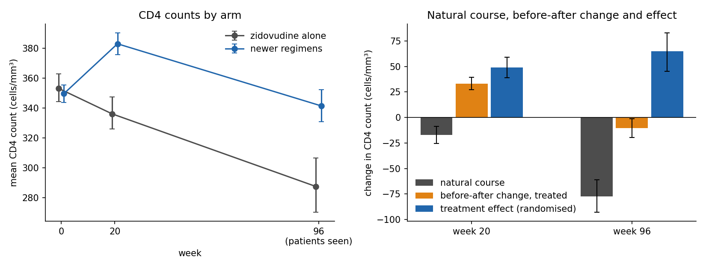
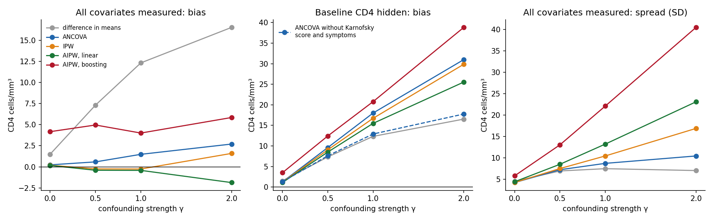
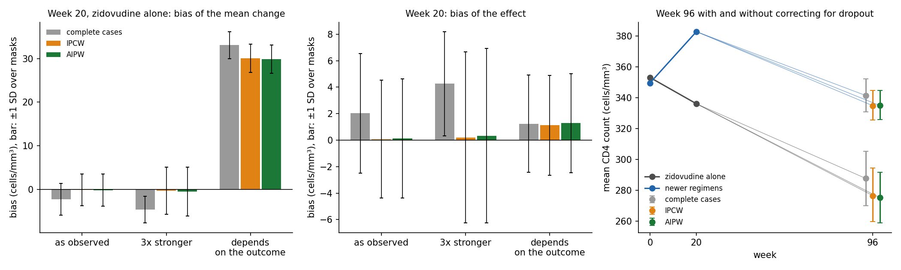
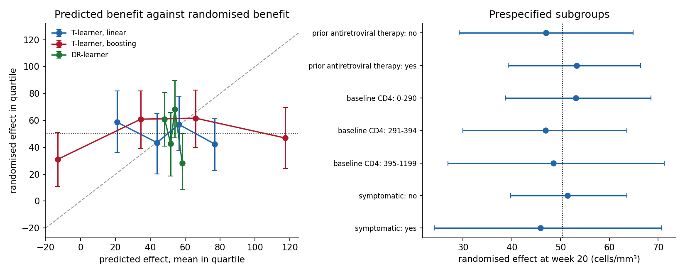

# Treatment effect or natural course? Causal estimates and missing follow-up checked against a randomised trial

A patient's marker changes after a treatment starts. How much of the change is the disease taking its course, and how much is the treatment? Can that be answered from data where treatment was not randomised, or where patients miss later visits?

This repository studies those questions on ACTG 175, a randomised trial of 2,139 adults with HIV. CD4 counts were measured at baseline, week 20 and week 96. Because the trial was randomised, its own answer is known, and every method can be checked against it. It covers:

- **Natural course and treatment effect:** what happens without the newer treatment, and why the change seen in treated patients is not the effect of treatment (E1).
- **Confounding with a known answer:** the trial is resampled so that sicker patients are more likely to be treated, as in routine care. Five estimators try to recover the trial's answer, with the confounder measured or hidden (E2).
- **Missing follow-up:** one patient in three has no week-96 count. Who drops out, which corrections work, and when they cannot (E3).
- **Who benefits:** whether predicted individual benefit holds up against randomised contrasts (E4).

Confidence intervals are 95% intervals from a bootstrap with 1,000 resamples of patients unless stated otherwise. Simulations repeat each setting 500 times.

This is the fourth study in a series with [missing-pieces-ecg](https://github.com/sabaso94/missing-pieces-ecg) (a deep ECG classifier with missing leads, subgroups and shift), [missing-pieces-wearable](https://github.com/sabaso94/missing-pieces-wearable) (mortality risk from a wrist wearable and clinical data when parts are missing) and [missing-pieces-retina](https://github.com/sabaso94/missing-pieces-retina) (a retinal screening model at clinics it never saw). Here the missing pieces are the counterfactual (what would have happened without treatment) and the visits patients did not attend.

## Motivation

Most data on how a disease progresses under treatment come from routine care, not from trials. There, the patients who receive a treatment differ from those who do not, and follow-up thins out over time. Two things can then go wrong:

- **The disease's own course is mistaken for the treatment's effect,** or the other way round. A marker that falls under treatment may still have fallen less than it would have without it.
- **Missing visits are not random.** If the patients who do worst stop coming, the patients still seen paint too good a picture.

Causal methods (adjustment, weighting, doubly robust estimators) and corrections for dropout are meant to fix both. Whether they do, on a given data set, can rarely be checked, because the true answer is unknown. A randomised trial supplies it. This study uses the trial's answer as ground truth and asks how close each method gets when the data are made to look like routine care.

## Data and setup

| | |
|---|---|
| Trial | ACTG 175 (Hammer et al., 1996): adults with HIV and CD4 counts of 200–500 cells/mm³, randomised to zidovudine alone (532) or one of three newer regimens: zidovudine with didanosine (522), zidovudine with zalcitabine (524) or didanosine alone (561) |
| Source | The data set `ACTG175` of the R package speff2trial 1.0.5 on CRAN (Juraska et al., GPL-2), one row per patient |
| Treatment | Any of the three newer regimens (1,607 patients) against zidovudine alone (532), unless stated |
| Outcome | Change in CD4 count from baseline to week 20 (complete for every patient) and to week 96 (missing for 797 patients, 37%) |
| Baseline covariates (15) | Age, weight, Karnofsky score, CD4 and CD8 counts, days of prior antiretroviral therapy, any prior antiretroviral therapy, zidovudine in the 30 days before, other prior antiretroviral therapy, haemophilia, homosexual activity, intravenous drug use, race, sex, symptoms. Nothing measured after randomisation is used as a covariate |
| Trial's answer | The week-20 effect estimated on all 2,139 patients by ANCOVA (outcome regressed on treatment and the baseline covariates): **+49.1 cells/mm³** [39.0, 59.2] |

The trial's primary endpoint was a combined clinical event; this study uses the CD4 count, the marker of disease progression that was measured repeatedly.

**Estimators** of the average effect of treatment:

- **Difference in means:** right only when treatment is randomised.
- **ANCOVA:** least squares of the outcome on treatment and covariates, robust (HC1) standard errors.
- **IPW:** inverse probability weighting with a logistic model for the probability of treatment (normalised weights).
- **AIPW:** augmented IPW, doubly robust: correct if either the outcome models or the treatment model is right (Robins et al., 1994; Bang and Robins, 2005). Both models are fitted by 5-fold cross-fitting (Chernozhukov et al., 2018), as linear models or as gradient-boosted trees.

## Results

### E1: natural course and treatment effect



Change in CD4 count (cells/mm³) against zidovudine alone:

| Comparison | Week | Natural course (zidovudine alone) | Before-after, treated | Effect, difference in means | Effect, ANCOVA |
|---|---|---|---|---|---|
| newer regimens | 20 | -17.1 [-25.5, -8.8] | +33.3 [+27.2, +39.6] | +50.4 [+39.7, +61.0] | +49.1 [+39.0, +59.2] |
| newer regimens | 96 | -77.5 [-93.0, -61.2] | -10.4 [-19.7, -1.4] | +67.1 [+47.2, +86.0] | +64.9 [+45.3, +83.0] |
| zidovudine + didanosine | 20 | -17.1 [-26.3, -8.1] | +54.4 [+41.8, +67.2] | +71.5 [+55.5, +86.6] | +69.7 [+55.7, +84.3] |
| zidovudine + didanosine | 96 | -77.5 [-93.5, -60.7] | -6.9 [-23.2, +8.9] | +70.6 [+49.2, +93.0] | +69.0 [+47.9, +91.2] |
| zidovudine + zalcitabine | 20 | -17.1 [-25.8, -7.9] | +19.3 [+10.2, +28.9] | +36.3 [+23.9, +49.1] | +36.2 [+24.6, +47.9] |
| zidovudine + zalcitabine | 96 | -77.5 [-92.1, -61.8] | -4.4 [-20.3, +12.1] | +73.1 [+50.4, +95.4] | +70.1 [+47.9, +91.5] |
| didanosine | 20 | -17.1 [-26.2, -8.2] | +26.9 [+17.2, +36.4] | +43.9 [+31.2, +56.4] | +41.9 [+30.5, +53.9] |
| didanosine | 96 | -77.5 [-92.4, -61.3] | -19.4 [-33.5, -4.9] | +58.1 [+36.6, +77.8] | +55.3 [+33.4, +75.6] |

- **Without the newer regimens, CD4 counts fall.** On zidovudine alone they drop by 17 cells/mm³ by week 20 and by 78 by week 96. This is the natural course the newer regimens are measured against.
- **The change in treated patients is not the effect.** Patients on the newer regimens gain 33 cells/mm³ by week 20, but the effect is 49–50: their counts would have fallen without treatment. At week 96 the gap is starker. Treated patients have *lost* 10 cells/mm³, which on its own reads as treatment failure, yet they are 65–67 cells/mm³ better off than without the newer regimens.
- **The regimens differ at week 20** (from +36 for zidovudine with zalcitabine to +70 for zidovudine with didanosine) and are close at week 96 (+55 to +70).
- **Adjustment barely moves a randomised estimate.** ANCOVA and the difference in means agree within 3 cells/mm³ everywhere; adjustment narrows the interval slightly.

Week 96 counts only the patients seen at week 96; E3 asks whether that matters.

### E2: confounding with a known answer

In routine care, sicker patients are often treated differently. To mimic that, the trial is subsampled so that the probability of treatment rises with a severity score (low baseline CD4, low Karnofsky score, symptoms): P(treated | x) = expit(γ · severity), with γ from 0 (no confounding) to 2 (strong). A treated patient is kept with probability proportional to that target and a control with probability proportional to its complement, scaled so that every patient has the same chance of being kept: the samples keep the trial's mix of patients, so the trial's answer (+49.1) stays the right answer (observational sampling from a trial, Gentzel et al., 2021). Samples hold 1,066 patients on average at γ = 0 and 540 at γ = 2. In each of 500 samples per γ, five estimators adjust for:

- **all covariates** (the confounders are measured);
- **all but baseline CD4** (the strongest confounder is hidden);
- **all but baseline CD4, Karnofsky score and symptoms.**

Coverage is of the trial's answer by the 95% interval. Because each sample comes from the same patients as the trial's answer, the interval is narrowed by the finite-population factor √(1 − n/2,139); without confounding (γ = 0) coverage is then 0.91–0.98, as it should be.

Bias in cells/mm³ (SD across samples; coverage), all covariates measured:

| Estimator | γ = 0 | γ = 0.5 | γ = 1 | γ = 2 |
|---|---|---|---|---|
| difference in means | +1.5 (4.6; 0.96) | +7.3 (7.0; 0.85) | +12.3 (7.5; 0.71) | +16.5 (7.1; 0.50) |
| ANCOVA | +0.2 (4.3; 0.96) | +0.6 (7.3; 0.96) | +1.5 (8.7; 0.95) | +2.7 (10.5; 0.95) |
| IPW | +0.2 (4.3; 0.98) | -0.2 (7.5; 0.98) | -0.3 (10.5; 0.97) | +1.6 (16.9; 0.91) |
| AIPW, linear | +0.2 (4.4; 0.96) | -0.4 (8.5; 0.97) | -0.4 (13.2; 0.95) | -1.9 (23.1; 0.93) |
| AIPW, boosting | +4.2 (5.8; 0.91) | +5.0 (13.1; 0.93) | +4.0 (22.1; 0.96) | +5.8 (40.5; 0.94) |

Baseline CD4 hidden:

| Estimator | γ = 0 | γ = 0.5 | γ = 1 | γ = 2 |
|---|---|---|---|---|
| difference in means | +1.5 (4.6; 0.96) | +7.3 (7.0; 0.85) | +12.3 (7.5; 0.71) | +16.5 (7.1; 0.50) |
| ANCOVA | +1.2 (4.4; 0.97) | +9.6 (7.4; 0.79) | +18.0 (8.7; 0.48) | +31.0 (10.0; 0.11) |
| IPW | +1.2 (4.4; 0.97) | +9.0 (7.3; 0.82) | +16.7 (8.8; 0.56) | +29.9 (11.7; 0.27) |
| AIPW, linear | +1.1 (4.6; 0.97) | +8.5 (7.9; 0.86) | +15.5 (10.1; 0.69) | +25.5 (17.1; 0.54) |
| AIPW, boosting | +3.5 (6.3; 0.93) | +12.4 (12.6; 0.83) | +20.8 (19.7; 0.75) | +38.8 (31.4; 0.70) |

Baseline CD4 hidden, and Karnofsky score and symptoms left out of the adjustment:

| Estimator | γ = 0 | γ = 0.5 | γ = 1 | γ = 2 |
|---|---|---|---|---|
| difference in means | +1.5 (4.6; 0.96) | +7.3 (7.0; 0.85) | +12.3 (7.5; 0.71) | +16.5 (7.1; 0.50) |
| ANCOVA | +1.3 (4.4; 0.97) | +7.6 (7.0; 0.84) | +12.9 (7.5; 0.67) | +17.8 (7.3; 0.43) |
| IPW | +1.2 (4.4; 0.97) | +7.7 (7.0; 0.84) | +13.0 (7.5; 0.68) | +17.9 (7.2; 0.45) |
| AIPW, linear | +1.1 (4.5; 0.96) | +7.8 (7.6; 0.85) | +13.5 (8.5; 0.72) | +18.0 (8.9; 0.51) |
| AIPW, boosting | +4.4 (6.5; 0.89) | +12.7 (12.1; 0.82) | +17.9 (14.2; 0.76) | +21.1 (13.6; 0.70) |



- **Without adjustment, confounding shows.** The difference in means overstates the effect by 7 to 17 cells/mm³ as γ rises, and its interval covers the trial's answer in only half the samples at γ = 2.
- **With the confounders measured, adjustment recovers the trial's answer.** ANCOVA, IPW and linear AIPW stay within 3 cells/mm³ of it at every γ, with coverage 0.91–0.98.
- **Weighting pays for poor overlap.** At γ = 2 few sick patients are untreated, and the weights put much on them. The SD across samples is 10.5 for ANCOVA, 16.9 for IPW and 23.1 for linear AIPW. Double robustness protects against a wrong model, not against too little data on one side.
- **Flexible models do not help on a few hundred patients.** AIPW with boosted trees is 4–6 cells/mm³ too high at every γ, even without confounding, and its SD reaches 40.5 at γ = 2.
- **With the main confounder hidden, every adjustment fails, and adjusting makes it worse than not adjusting.** At γ = 2 the adjusted estimates are 26–39 cells/mm³ too high against 17 for the unadjusted difference, and coverage falls to 0.11–0.70. The reason is bias amplification (Pearl, 2010; Myers et al., 2011): Karnofsky score and symptoms drive treatment in these samples but barely the outcome (their correlation with the week-20 change is below 0.05). Adjusting for them removes treatment variation unrelated to baseline CD4, so what remains is more confounded. Leaving them out brings the bias back to the unadjusted level (+18 at γ = 2).
- **A sensitivity analysis gets the direction right.** For the ANCOVA estimate with baseline CD4 hidden, the robustness value (Cinelli and Hazlett, 2020) is 0.20–0.26: a hidden confounder would need to explain a quarter of the remaining variance of both treatment and outcome to remove the estimate. Baseline CD4 explains 8% of the outcome's and up to 13% of the treatment's, so it could not, and indeed the true effect is clearly positive. If the analyst can say how strong the hidden confounder is, the same analysis gives the size of its bias: 28 cells/mm³ at γ = 2, against a realised error of 31.

Measured confounders make the methods work; a hidden one cannot be adjusted away, and adjusting for the wrong variables makes it worse. What can be done without the confounder is to ask how strong it would have to be.

### E3: missing follow-up

One patient in three has no week-96 count (36–40% in every arm).

**Who drops out.** A logistic model on baseline and arm predicts dropout only weakly: cross-validated AUROC 0.57, and 0.58 with the week-20 count added. Patients with a lower Karnofsky score and a lower week-20 count are more likely to be missing. Those missing at week 96 had already done worse by week 20: −22 against −14 cells/mm³ on zidovudine alone, and +24 against +39 on the newer regimens.

**A check with a known answer.** Week 20 is complete, so dropout can be imposed on it and the estimates scored against the full data. Three mechanisms, each keeping each arm's real dropout rate, 500 masks each:

- **As observed:** the real dropout model, fitted on the baseline covariates in each arm.
- **3× stronger:** the same model with its coefficients tripled.
- **Depends on the outcome:** the patients with a lower week-20 change are more likely to be missing (log-odds −1 per SD), whatever their covariates.

Complete cases are compared with inverse probability of censoring weighting (IPCW; Robins et al., 1995) and a doubly robust correction (AIPW), both using the baseline covariates. Bias, with root mean squared error in brackets (cells/mm³):

| Dropout | Quantity | Complete cases | IPCW | AIPW |
|---|---|---|---|---|
| as observed | mean change, zidovudine alone | -2.3 (4.3) | -0.1 (3.6) | -0.2 (3.7) |
| as observed | mean change, newer regimens | -0.2 (2.3) | -0.0 (2.3) | -0.0 (2.3) |
| as observed | effect | +2.0 (4.9) | +0.1 (4.4) | +0.1 (4.5) |
| 3x stronger | mean change, zidovudine alone | -4.6 (5.5) | -0.3 (5.4) | -0.4 (5.6) |
| 3x stronger | mean change, newer regimens | -0.4 (2.3) | -0.1 (3.1) | -0.1 (3.1) |
| 3x stronger | effect | +4.3 (5.8) | +0.2 (6.4) | +0.3 (6.6) |
| depends on the outcome | mean change, zidovudine alone | +33.0 (33.2) | +30.0 (30.2) | +29.9 (30.0) |
| depends on the outcome | mean change, newer regimens | +34.3 (34.3) | +31.1 (31.2) | +31.1 (31.2) |
| depends on the outcome | effect | +1.2 (3.9) | +1.1 (3.9) | +1.3 (3.9) |
| Quantity | Complete cases | IPCW | AIPW |
|---|---|---|---|
| CD4 at week 96, zidovudine alone | 287.6 [269.9, 305.3] | 276.5 [259.7, 294.3] | 275.1 [258.7, 291.7] |
| CD4 at week 96, newer regimens | 341.4 [331.0, 352.2] | 334.9 [325.7, 344.7] | 335.0 [325.8, 344.7] |
| change to week 96, zidovudine alone | -77.5 [-92.4, -61.3] | -77.8 [-91.7, -61.9] | -78.1 [-92.2, -61.9] |
| change to week 96, newer regimens | -10.4 [-19.5, -1.0] | -14.6 [-23.6, -6.3] | -14.6 [-23.7, -6.1] |
| effect at week 96 | +67.1 [+49.7, +84.6] | +63.2 [+46.3, +80.3] | +63.4 [+47.0, +80.1] |



- **When dropout depends on what was measured, the corrections remove the bias.** With dropout as observed, complete cases understate the mean change on zidovudine alone by 2.3 and overstate the effect by 2.0; IPCW and AIPW are within 0.2. With dropout 3× stronger, complete cases are off by 4.6 and 4.3; the corrections stay within 0.4.
- **Removing bias costs precision.** With the stronger dropout, the corrections' spread rises enough that their root mean squared error for the effect (6.4–6.6) is higher than that of complete cases (5.8). For dropout as weak as in this trial, complete cases lose little.
- **When dropout depends on the outcome itself, nothing fixes the means.** Every method overstates the mean change by about 30 cells/mm³ in both arms, as only patients doing well remain. The corrections recover a tenth of it at most: the covariates say little about who does well.
- **The effect survives, by luck of symmetry.** Because the same kind of patient drops out in both arms, the error largely cancels in the difference (+1.1 to +1.3). A mechanism that differed between arms would not cancel.

**Week 96.** Correcting with everything known before the visit (baseline covariates and the week-20 count):

| Quantity | Complete cases | IPCW | AIPW |
|---|---|---|---|
| CD4 at week 96, zidovudine alone | 287.6 [269.9, 305.3] | 276.5 [259.7, 294.3] | 275.1 [258.7, 291.7] |
| CD4 at week 96, newer regimens | 341.4 [331.0, 352.2] | 334.9 [325.7, 344.7] | 335.0 [325.8, 344.7] |
| change to week 96, zidovudine alone | -77.5 [-92.4, -61.3] | -77.8 [-91.7, -61.9] | -78.1 [-92.2, -61.9] |
| change to week 96, newer regimens | -10.4 [-19.5, -1.0] | -14.6 [-23.6, -6.3] | -14.6 [-23.7, -6.1] |
| effect at week 96 | +67.1 [+49.7, +84.6] | +63.2 [+46.3, +80.3] | +63.4 [+47.0, +80.1] |

- **Complete cases overstate how well patients are doing at week 96** by 11–12 cells/mm³ on zidovudine alone and about 6 on the newer regimens, consistent with the patients doing worse dropping out.
- **The effect is slightly smaller once dropout is corrected:** +63 against +67 cells/mm³; the change on the newer regimens is −15 rather than −10. The conclusion of E1 stands.
- **This rests on dropout depending only on what was measured before it.** The simulation shows what happens if it does not; the data cannot tell the two apart.

### E4: who benefits

Every contrast below is randomised, so it is unconfounded; the question is whether the effect differs between patients. Week-20 effect in groups fixed in advance, and the difference between the last and first group:

| Subgroup | Patients | Effect | Difference |
|---|---|---|---|
| prior antiretroviral therapy: no | 886 | +46.9 [+29.2, +64.8] | +6.3 [-17.4, +26.9] |
| prior antiretroviral therapy: yes | 1253 | +53.3 [+39.2, +66.4] |  |
| baseline CD4: 0-290 | 723 | +53.1 [+38.7, +68.5] | -4.6 [-31.0, +20.8] |
| baseline CD4: 291-394 | 705 | +46.9 [+30.0, +63.6] |  |
| baseline CD4: 395-1199 | 711 | +48.5 [+26.9, +71.2] |  |
| symptomatic: no | 1769 | +51.4 [+39.7, +63.6] | -5.5 [-31.1, +22.6] |
| symptomatic: yes | 370 | +45.9 [+24.1, +70.6] |  |

No subgroup's effect differs from another's: every difference has an interval spanning zero, and every group's effect is within 5 cells/mm³ of the overall +50.

**Predicted benefit.** Three learners predict each patient's effect from the baseline covariates, out of fold (5-fold cross-fitting): a T-learner (separate outcome models per arm, linear or boosted; Künzel et al., 2019) and a DR-learner (a doubly robust pseudo-outcome with the trial's known treatment probability, regressed on the covariates with a ridge penalty; Kennedy, 2023). Patients are cut into quartiles of predicted benefit, and within each quartile the randomised effect checks the prediction:

| Learner | SD of predictions | Q1: predicted / randomised | Q2: predicted / randomised | Q3: predicted / randomised | Q4: predicted / randomised | Q4 − Q1 |
|---|---|---|---|---|---|---|
| T-learner, linear | 22 | 21 / 59 [36, 82] | 44 / 43 [20, 65] | 56 / 57 [37, 78] | 77 / 42 [23, 61] | -16.2 [-45.2, +14.5] |
| T-learner, boosting | 52 | -13 / 31 [11, 51] | 35 / 61 [39, 82] | 66 / 62 [40, 83] | 117 / 47 [24, 70] | +16.0 [-13.5, +47.7] |
| DR-learner | 4 | 48 / 61 [41, 81] | 52 / 43 [18, 66] | 54 / 68 [47, 90] | 58 / 28 [8, 50] | -32.8 [-59.0, -0.4] |
| Subgroup | Patients | Effect | Difference |
|---|---|---|---|
| prior antiretroviral therapy: no | 886 | +46.9 [+29.2, +64.8] | +6.3 [-17.4, +26.9] |
| prior antiretroviral therapy: yes | 1253 | +53.3 [+39.2, +66.4] |  |
| baseline CD4: 0-290 | 723 | +53.1 [+38.7, +68.5] | -4.6 [-31.0, +20.8] |
| baseline CD4: 291-394 | 705 | +46.9 [+30.0, +63.6] |  |
| baseline CD4: 395-1199 | 711 | +48.5 [+26.9, +71.2] |  |
| symptomatic: no | 1769 | +51.4 [+39.7, +63.6] | -5.5 [-31.1, +22.6] |
| symptomatic: yes | 370 | +45.9 [+24.1, +70.6] |  |



- **The T-learners predict benefits that are not there.** The boosted T-learner predicts effects from −13 to +117 cells/mm³ across quartiles; the randomised effects in those quartiles are 31–62 and do not rise with the prediction (top minus bottom +16 [−14, 48]). The linear T-learner's spread from 21 to 77 is likewise not borne out.
- **The DR-learner predicts nearly the same effect for everyone** (48–58), which is what the randomised contrasts support. Its quartile contrast (−33 [−59, −0.4]) runs against its own prediction over a predicted range of 10 cells/mm³; one of three such contrasts with an interval just excluding zero is what chance alone produces.
- **A model can always produce individual predictions; only randomised contrasts say whether they mean anything.** Here they say the newer regimens helped about equally across the measured patient characteristics.

## Limitations

- **One trial, one marker.** The CD4 count is a marker of HIV progression, not a clinical outcome, and two follow-up visits make a short trajectory. The methods carry over; the numbers do not.
- **Simulated confounding is simple.** In E2 treatment depends on three baseline characteristics through a logistic model. Real treatment decisions depend on more, including things never recorded.
- **The truth is itself an estimate.** The trial's answer has its own uncertainty (±10 cells/mm³). Every sample in E2 is drawn from the same patients, so coverage is measured with a finite-population correction; without confounding it comes out at 0.91–0.98.
- **Week 96 is not observed after death.** A patient who dies before week 96 has no count to miss, and the data record a combined event (CD4 halving, AIDS or death), not death alone. Dropout is as common with this event as without it (37% in both), but the corrected means treat every missing count as one that could have been measured.
- **Small samples for flexible models.** The confounded samples hold 540–1,070 patients, which favours simple models; with more data, boosted nuisance models may do better.

## Reproduce

```bash
python -m venv .venv
.venv/bin/pip install -U pip "setuptools>=64"
.venv/bin/pip install -r requirements.txt
.venv/bin/pip install -e .
bash scripts/run_all.sh
```

Everything runs on CPU. Set `JOBS` to the number of parallel workers for E2 (default 8). `run_all.sh` runs the whole pipeline in order:

1. downloads the speff2trial package from CRAN, keeps only `ACTG175.txt` and checks its checksum;
2. runs the tests;
3. writes the cohort report;
4. runs E1, E2, E3 and E4;
5. draws the figures.

Results are written to `results/` and figures to `figures/`. E2 takes about 15 minutes with 8 workers; the rest takes about 2 minutes.

```
src/trial_trajectories/   data, average-effect estimators, confounded sampling, sensitivity analysis,
                          dropout corrections, heterogeneous effects, bootstrap
scripts/                  download, cohort report, one script per experiment, figures, run_all.sh
tests/                    unit tests (pytest), runnable without the data
results/                  all reported numbers as CSV
figures/                  the figures above
```

## References

- Bang H, Robins JM (2005). Doubly robust estimation in missing data and causal inference models. *Biometrics* 61:962–973.
- Chernozhukov V, Chetverikov D, Demirer M, Duflo E, Hansen C, Newey W, Robins J (2018). Double/debiased machine learning for treatment and structural parameters. *The Econometrics Journal* 21:C1–C68.
- Cinelli C, Hazlett C (2020). Making sense of sensitivity: extending omitted variable bias. *Journal of the Royal Statistical Society: Series B* 82:39–67.
- Gentzel AM, Pruthi P, Jensen D (2021). How and why to use experimental data to evaluate methods for observational causal inference. *Proceedings of the 38th International Conference on Machine Learning*, PMLR 139:3660–3671.
- Hammer SM, Katzenstein DA, Hughes MD, et al. (1996). A trial comparing nucleoside monotherapy with combination therapy in HIV-infected adults with CD4 cell counts from 200 to 500 per cubic millimeter. *New England Journal of Medicine* 335:1081–1090.
- Juraska M, Gilbert PB, Lu X, Zhang M, Davidian M, Tsiatis AA. speff2trial: semiparametric efficient estimation for a two-sample treatment effect. R package version 1.0.5, CRAN.
- Kennedy EH (2023). Towards optimal doubly robust estimation of heterogeneous causal effects. *Electronic Journal of Statistics* 17:3008–3049.
- Künzel SR, Sekhon JS, Bickel PJ, Yu B (2019). Metalearners for estimating heterogeneous treatment effects using machine learning. *PNAS* 116:4156–4165.
- Myers JA, Rassen JA, Gagne JJ, et al. (2011). Effects of adjusting for instrumental variables on bias and precision of effect estimates. *American Journal of Epidemiology* 174:1213–1222.
- Pearl J (2010). On a class of bias-amplifying variables that endanger effect estimates. *Proceedings of the 26th Conference on Uncertainty in Artificial Intelligence*, PMLR R8:424–431.
- Robins JM, Rotnitzky A, Zhao LP (1994). Estimation of regression coefficients when some regressors are not always observed. *Journal of the American Statistical Association* 89:846–866.
- Robins JM, Rotnitzky A, Zhao LP (1995). Analysis of semiparametric regression models for repeated outcomes in the presence of missing data. *Journal of the American Statistical Association* 90:106–121.
